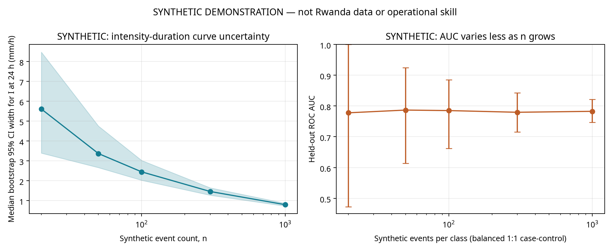

# Rwanda Landslide Early Warning System: Updated Feasibility and Data-Readiness Assessment

**Version 2.0 — 18 October 2026**  
Prepared by Manus AI

## Executive summary

The new REMA 2022 report materially changes the assessment of **static landslide susceptibility and historical area-rate mapping**. It documents a regional shallow-landslide analysis using 2,544 manually mapped initiation points, a logistic-regression susceptibility model, annualized source-area rates by susceptibility class, and exposure overlays for four western Rwanda sub-catchments. Its selected 30 m model reported AUC 88.8% under random 10-fold cross-validation. The report also identifies a separate local inventory of 22 old and 5 recent deep-seated failures. These are two different inventories with different purposes, scales and time information. [4]

It does **not** change the earlier conclusion about a rainfall-trigger early-warning model. The 2,544 points are not 2,544 independent, day-dated triggering episodes: their occurrence timing is bounded between satellite-image dates, and the report does not publish the image-pair dates with the mapped points. The 88-row incident compilation contains only 25 rows meeting the strict day + one district + linked site + rain-trigger screen, with 21 distinct dates before duplicate/storm adjudication. Neither inventory supplies a complete panel of monitored non-event days or measured rainfall for this analysis. Accordingly, no new Rwanda trigger threshold, real-data cross-validation result, calibrated warning probability, or operational EWS skill estimate is claimed. [1] [3] [4]

The REMA AUC is useful as a **published, source-specific susceptibility result**, not proof that 89–91% performance will transfer to spatially separate locations or future events. REMA used random pseudo-absences and random 10-fold CV. No spatial-block, temporal, independent-event, or prospective evaluation is reported. Spatial dependence and background-sampling choices can make random CV optimistic, but the direction and size of any Rwanda performance change cannot be computed from the report alone. [4] [15] [16]

A larger public 7,944-point Kivu-region inventory was located under CC BY 4.0, but its point file is not confirmed to be the exact 2,544-point REMA input. Its raw `Year` field contains signed integers with no verified sign convention, and it has no image-pair dates or explicit landslide-type field. A separate public 2018 Rwanda mixed-hazard polygon file contains 494 features but no per-feature landslide-versus-flash-flood class. Neither is an interchangeable substitute for the REMA training layer. [8] [9] [13]

**Bottom line:** the 2,544-point source makes a static susceptibility/historical-rate replication a realistic next research task if the exact layer, predictor inputs and sampling recipe can be obtained. It does not create day-level rainfall labels. Keep susceptibility, rainfall-trigger probability, exposure and response as separately validated components. The included real-data replication script deliberately refuses to produce a result without a prepared, provenance-documented table. The only new performance and sample-size numbers in this package are explicitly synthetic code demonstrations.

## 1. Existing 88-event dataset: what is and is not ready

The version-2 repository snapshot contains 88 curated event rows and 1,071 site/geometry rows. The site table combines 494 polygons, 494 centroids derived from those polygons, 77 other point sites and 6 contextual area-of-interest centers. The source QA report warns that the 2018 polygons are mixed landslide/flash-flood features without per-feature class and that their derived centroids are not observed scar points. The six area centers are contextual, not landslide occurrences. [1] [3]

The reproducible screening script finds 66 day-precision records, 56 with a day and named district, 43 with a day and exactly one district, 33 with a linked site, and 25 satisfying the strict day + one district + linked site + rain/prolonged-rain trigger screen. The 25 rows cover 21 distinct dates. These are **eligibility screens, not 25 independent rainfall events**: same-date reports may be duplicate claims or separate failures in a shared storm, trigger classification is not rainfall measurement, and the event table does not provide all eligible non-event opportunities. No point site has stated positional accuracy of 1 km or better. [1] [3]

The 88-record compilation is closer to a set of reported incident claims than a complete occurrence census. It can support an auditable incident ledger, source reconciliation, data requests and carefully qualified event-day matching after adjudication. It cannot, by itself, support a national probability surface, a reliable fine-scale point-validation sample, a return-period estimate, or standard false-alarm and specificity metrics. The 1,071 geometry rows must not be counted as 1,071 independent events. [1] [3]

The version-2 readiness outputs and source tables are preserved in [the readiness output folder](outputs/readiness_real/), [the data dictionary](input/DATA_DICTIONARY.md), [the QA report](input/QA_REPORT.md), and [the source registry](input/sources.csv).

## 2. What REMA’s 2022 report actually did

### 2.1 Two inventories, not one interchangeable catalogue

REMA names four study sub-catchments: Bishenyi, Rwabayanga, Rusizi/Kamembe–Gihundwe and Rwandex–Magerwa. Names vary between sections and tables, including “Magerwa” versus “Rwandex–Magerwa”; geometries should be reconciled before site-level values are joined. [4, PDF p. 5; printed p. 4]

The **local inventory** was created through 3-D visual interpretation of Google Earth imagery with stated spatial resolution of 30–60 cm. Step 1 describes imagery captured from 2000 to 2021 and says field photographs were also used. Shallow landslides are visually classified as estimated depth below 5 m. Within the four local catchments the report maps 22 old deep-seated landslides and 5 recent deep-seated flow slides/earthflows. “Recent” means that activity lies between image dates; “old” means visible in the oldest imagery without visible activity. These are mostly polygonal ground-deformation features, and the age of the old failures is undetermined. [4, PDF pp. 9–10; printed pp. 8–9]

The **regional shallow-landslide inventory** has a different role. The report says it used 2,544 shallow-landslide observations visually identified in Google Earth imagery over 2000–2019 in western Rwanda. Each slide is represented by one manually located initiation point or pixel. Its timing is constrained between two satellite-image dates, not to a day. The source area averages 121 m² and the impact area 604 m², for 725 m² total; only the initiation/source area enters the susceptibility analysis. The report uses 83 non-stationary knickpoints to delineate rejuvenated from relict landscapes. Figure 3 also shows two point clusters attributed to intense convective-rainfall events. [4, PDF pp. 15–16; printed pp. 14–15]

The report itself says the four-catchment local inventory was too limited for a data-driven susceptibility/hazard model, so it used the broader regional shallow-landslide dataset. It also states that no shallow features were identified in the four catchments during the preceding approximately 20 years, while cautioning that this does not mean none occurred: small failures can be missed or obscured. Creep/gully mapping is not comprehensive, and very small road failures may not be visible in Google Earth. [4, PDF pp. 11–14; printed pp. 10–13]

### 2.2 Predictors, model, and reported validation

Table 1 lists terrain and environmental predictors at mixed native scales: elevation, slope, profile and planar curvature, north/east exposure, rejuvenated landscape, distance to rivers, lithology, distance to faults, peak ground acceleration, land cover, road presence within 50 m, and clay content. Terrain predictors use 10 m or 30 m data; peak ground acceleration is listed at 2.2 km; the rejuvenated-landscape layer is 1:1,000. The report says the model uses 2,544 initiation points plus an equal number of randomly sampled non-landslide/background points from outside landslide areas. It applies forward stepwise logistic regression and random 10-fold cross-validation. [4, PDF pp. 17, 19; printed pp. 16, 18]

| DEM/model variant | Reported AUC | REMA’s selection note |
|---|---:|---|
| 10 m, with lithology | 89.3% | Lithology included |
| 10 m, without lithology | 85.0% | Lithology excluded |
| 30 m, with lithology | 91.1% | Lithology included |
| 30 m, without lithology | 88.8% | Selected model; lithology considered too coarse for the watershed scale and the difference marginal |

*Source: REMA Table 2, PDF p. 19, printed p. 18. The 30 m/no-lithology result is the selected model in this report, not an independently verified estimate of future performance.* [4]

Figure 4 calls its “variable importance” a univariate AUC analysis. Its highest labeled values are slope 88.9%, elevation 63.1%, distance to faults 60.0%, distance to rivers 59.0%, and planar curvature 58.4%. Other labeled values range from 50.4% to 55.2%. This is not permutation importance or a measure of causal effect in the selected multivariable model. The authors note that small road failures may be underrepresented in the imagery and that DEM terrain cannot capture engineered road cuts. [4, PDF p. 20; printed p. 19]

Appendix 1 reports VIF values from 1.00 to 3.46 and says none exceeded its VIF >4 flag. Its condition-index discussion treats values above 30 as concerning and reports no problematic multicollinearity. These checks address correlation among predictors; they do not address spatial leakage, biased sampling, date uncertainty, model calibration, or external prediction. [4, PDF pp. 38–39; printed pp. 37–38]

### 2.3 Hazard-rate construction and Figures 6–7

REMA converts static susceptibility into a retrospective **landslide affected-area rate**. For each susceptibility class, mapped source area over an observation period of about 20 years is divided by time and normalized per square kilometre, in m²/year/km². Figure 6 shows the affected-area rate increasing with susceptibility. The report’s approximate curve readings are about 400 m²/year/km² for susceptibility 0.9–1.0 and about 150 for 0.8–0.9. Its discrete Table 6 values are 365, 90, 18 and 1 m²/year/km² for the 0–10%, >10–30%, >30–60% and >60–100% susceptibility classes, respectively. [4, PDF pp. 24–26; printed pp. 23–25]

Figure 7 contrasts the distribution of susceptibility values with the same distribution weighted by landslide rates. REMA describes Rwandex–Magerwa as having the highest average hazard and Rwabayanga the lowest. Table 7 shows that the highest rate class occupies 0.71 km² (1.5%) of Bishenyi, 0.05 km² (0.6%) of Rwabayanga, 0.02 km² (0.1%) of Rusizi and 0.08 km² (0.8%) of Rwandex–Magerwa. Those figures are class-area shares within the study sites, not event probabilities. [4, PDF pp. 25, 27; printed pp. 24, 26]

| Susceptibility class | Average source-area rate in REMA Table 6 |
|---|---:|
| 0–10%, highest susceptibility | 365 m²/year/km² |
| >10–30% | 90 m²/year/km² |
| >30–60% | 18 m²/year/km² |
| >60–100% | 1 m²/year/km² |

*The first class is the top 10% of the susceptibility ranking, not a “10% chance” of failure. Table 7’s site-specific area percentages differ by catchment.* [4, PDF pp. 26–27; printed pp. 25–26]

### 2.4 Exposure and mitigation results

REMA overlays hazard classes with current 2018 land-use categories and a projected 2050 master plan. The report says vulnerability databases were not received. These are therefore desktop exposure intersections, not estimates of expected deaths, damage, household vulnerability or monetary loss. The highest rate class in the 2018 table includes, for example, 19.56 ha of agricultural land and 0.26 ha of residential/commercial land in Bishenyi; 1.28 ha of agricultural land in Rwabayanga; and 0.56 ha of residential/commercial land in Magerwa. In the 2050 plan’s highest class, selected values include 51.39 ha of forest and 17.29 ha of agricultural land in Bishenyi; 1.17 ha of public/commercial/industrial facilities in Rwabayanga; and 7.46 ha of forest in Rwandex–Magerwa. Table 8 labels one site “Magerwa”; Table 9 uses “Rwandex–Magerwa.” All units and the full color-class rows are preserved in the [page-referenced extraction CSV](rema_extraction_table.csv). [4, PDF pp. 28–30; printed pp. 27–29]

For its two highest hazard classes, 365 and 90 m²/year/km², REMA lists combined mapped areas of 666.7 ha in Bishenyi, 68.4 ha in Rwabayanga, 63.9 ha in Rwandex–Magerwa and 76.3 ha in Kamembe–Gihundwe. The mitigation chapter says no site-specific field measurements were taken; the proposed measures and costs are assumptions-based. It assumes 30% reforestation coverage and 500 m of trenches/ditches per 3 ha. Table 18 proposes agroforestry/progressive terraces, reforestation, trenches/ditches and, for Rwabayanga, gully rehabilitation. Its bill-of-quantities coverage fields are populated, but the unit-cost and total-cost columns are blank. [4, PDF pp. 58, 61; printed pp. 57, 60]

The report describes CROM DSS as using RUSLE for sheet/rill water erosion, not landslides or gullies. It warns that some erosion-control measures can increase infiltration and regolith water content, potentially creating landslide-favorable conditions. CROM DSS is not a landslide EWS or a substitute for site-specific hydrology/geotechnical review. [4, PDF p. 54; printed p. 53]

## 3. Critical assessment of the REMA method

### Random 10-fold CV and pseudo-absence sampling

An AUC of 88.8% means that, within the sampled positive/background contrast and the reported validation procedure, the model ranked a sampled initiation point above a sampled background point about 88.8% of the time. It does **not** mean that 88.8% of landslides will be warned correctly, that the predicted values are calibrated probabilities, or that performance will hold in a new district or future period. [4]

Random folds can place nearby locations or points associated with the same storm cluster in both training and test sets. If nearby points share slope, geology, rainfall regime, image visibility or reporting context, a model can exploit this shared structure without learning a relationship that transfers to a distant area. Spatial cross-validation studies show that random splits can be optimistic when dependence is present, while the magnitude depends on the study and block design. This evidence supports testing spatial blocks; it does not allow us to apply an external percentage drop to Rwanda. [15] [16]

The REMA background points are randomly sampled from the landscape outside mapped landslide areas. They are **pseudo-absences**, not verified non-failures observed during a comparable monitoring period. A 1:1 case-control sample can be useful for ranking locations, but it does not preserve the landscape prevalence needed for probability calibration. If points are sampled from terrain far from landslides or from areas with different image coverage, the model may separate the chosen samples more easily than it would distinguish future failures from monitored at-risk locations. Exact background coordinates, sampling seed and availability/visibility rules are not in the report. [4] [5] [8]

The AUC may therefore decline under spatial blocks or a later-period test, particularly if the mapped clusters are split across random folds. It could also remain similar if the selected predictor relationships transfer. The report does not disclose enough to determine whether the stepwise selection was repeated inside each fold, and no re-analysis of the actual 2,544 points was possible. The honest conclusion is **potential optimism with unknown size**, not a guessed adjusted AUC. [4] [15] [16]

### Hazard rate is not a rainfall trigger

The REMA rate is a retrospective rate of mapped source area per year and area unit, stratified by susceptibility. It has value for relative planning if the mapped inventory and observation window are suitable. It is not an intensity-duration threshold, a daily probability, a short-term forecast, an alert lead time, or a warning rule. It contains no current rainfall, antecedent soil wetness, weather forecast or response trigger. It cannot tell an agency whether to issue an alert today. [4]

The method assumes that mapped image coverage and landslide detection are sufficiently comparable across locations and through the observation period; that source-area delineation is consistent; and that dividing accumulated affected area by an approximately 20-year period is a useful average for planning. It also treats clustered failures through an average rate, although the report notes that convective storms can produce hundreds to thousands of failures over a small region and that areas outside mapped high-hazard classes may still be affected. Climate variability, changing land use, observation gaps and storm clustering all complicate interpretation. [4, PDF pp. 11, 24–27; printed pp. 10, 23–26]

Image-bracket dates can support retrospective timing only to the interval between the image pair. If the interval falls wholly within one rainy season, one can compare season-level rainfall totals or interval-censored event counts, with the exposed time at risk made explicit. If an interval spans multiple seasons or storms, assigning the slide to one daily rainfall event would be false precision. The report does not publish per-point image-pair dates. An event-based Sentinel-1/2 and field-report workflow could narrow some intervals, but satellite observations alone do not guarantee the failure day. Day-level rainfall thresholds require independently dated incident records, ideally with day/time bounds, storm identifiers and supporting rainfall-gauge/forecast data. [4] [5] [7] [17] [18]

### Imagery undercount and the “~2,700 years” interpretation

REMA correctly cautions that satellite interpretation misses some landslides. It argues that consistent Google Earth interpretation makes underestimation similar across the region, which could preserve broad relative rankings **if** observation coverage and detection probability are truly spatially uniform. That condition is not established. Depicker’s later published work describes spatial variation in image density, more imagery in urban settings and areas with no imagery, and adjusts frequency/erosion-rate analyses for image density. The point layer does not include the image footprints or per-location date brackets needed to reproduce that correction. [4] [5] [8] [9]

The “about 2,700 years” figure is an area-rate analogy: 1 km² contains 1,000,000 m², and a rate of 365 m²/year would accumulate an equivalent area over roughly that many years if the rate persisted. It is not an observed recurrence interval for each pixel and not a return period for a storm or slope failure. It assumes stationary rates and says nothing about spatial dependence, clustered events, or the chance that a particular slope fails. The report’s next step uses the assumed 5 m² impact area per 1 m² of initiation area to arrive at approximately 0.2% of a 1 km² area affected per year in the highest class, then states that about 1% may be affected after accounting for under-detection. The report gives no empirically estimated correction factor that would reproduce that increase, so the 1% value should be treated as a qualitative scenario, not a calibrated estimate. [4, PDF p. 27; printed p. 26]

## 4. Inventory access, licenses and data-owner routes

The source-by-source status, attempted access route, terms and contact route are documented in [the access log](data_access_log.csv), [the dataset crosswalk](inventory_dataset_crosswalk.csv), and [the evidence table](evidence_table.csv). No restricted data were downloaded and no access controls were bypassed.

| Source | Verified access and contents | Main limitation for this task |
|---|---|---|
| REMA 2022 report | Official REMA-hosted 68-page PDF is public. It documents the 2,544-point method and results. [4] | The exact 2,544 geometries, image-pair table and full predictor stack were not located in the report package. |
| Depicker et al. 2020a / 2020b source-registry labels | Both labels resolve to the same Geomorphology DOI and the same article, which describes an earlier 6,446-landslide catalogue. [1] [6] | These are duplicate bibliographic aliases, not two verified datasets. The exact 6,446-record file and its reuse license were not established. |
| Depicker et al. 2021, Earth Surface Dynamics | Open article and supplement route; the related public Zenodo record contains 7,944 shallow-landslide point geometries under CC BY 4.0. [5] [9] | Not confirmed as the exact REMA 2,544-point subset. Raw fields are `ID`, `area`, `dep_area`, `Year`; no field dictionary defines signed Year, field units, image pairs or explicit landslide type. |
| “In review” Kivu paper | It is now published as Depicker et al. 2021 in *Nature Sustainability*. The paper links its inventory to Zenodo 5027004 and figure data to a Figshare workbook. [8] [9] [10] | Figshare contains figure source data, not the underlying per-landslide spatial inventory. |
| Dewitte et al. 2021 | Publisher article describes a Google Earth inventory update, shallow source polygons and manually identified initiation points; image timing is between acquisitions. [7] | A separate exact 2,544-point file with per-point image brackets and a reuse license was not verified from the inspected route. |
| Monsieurs et al. 2018 | Publisher record describes LIWEAR with 143 events of known location and date across 1968–2016; supplementary material is listed for authorized users. [11] | No unrestricted event shapefile/CSV or reuse license was verified; publisher access restrictions were not bypassed. |
| Monsieurs et al. 2019 | Open NHESS article, CC BY 4.0; reports 174 events in 2001–2018, daily-accuracy dates and mean location accuracy 6.7 km; 29 mining events excluded and 143 used for threshold calibration. [12] | Supplement route is public, but no separate row-level occurrence-geometry file was verified in this review. The paper itself notes the catalogue is incomplete. |
| Deijns et al. / Zenodo 7198322 | Open CC BY 4.0 mixed-hazard inventory. The inspected Karongi layer has 494 polygons and fields for ID, area, land use, aspect, slope and Sentinel-1 ascending/descending masks. [13] | No per-feature date, initiation point, or explicit landslide-versus-flash-flood class. Do not treat all polygons as landslide positives. |
| Repository 4TU workbook snapshot | The included 70-row workbook snapshot has date/time, event text, location descriptions and accuracy, category/trigger, impacts and coordinates where supplied. Repository notes identify the 4TU source as CC0. [1] | It is an event catalogue, not scar polygons; coordinate quality and field completeness vary. The exact official 4TU record locator was not established in this review. |
| RMCA/Ghent geocatalogue | The inspected RMCA geocatalogue currently reports no information/layers. Official Ghent Geography contact page is available. [25] [26] | No separate public RMCA/Ghent event layer was verified there. |

Important bibliographic correction: the supplied source registry’s `depicker_2020a` and `depicker_2020b` labels both map to DOI 10.1016/j.geomorph.2019.106886. They are duplicate references to one 6,446-catalogue paper, not evidence of two distinct downloadable inventories. The separate 2021 Earth Surface Dynamics article and Zenodo record describe a public 7,944-point update; identity with the earlier catalogue or REMA’s 2,544-point subset is unverified. [1] [5] [6] [9]

The public 7,944-point shapefile is WGS 84 point geometry covering the North Tanganyika–Kivu region and has CC BY 4.0 terms. The downloaded archive is checksum-checked against the Zenodo record. Its raw `Year` values include 1,259 negatives and 6,685 positives across 34 distinct signed values; no field dictionary explains the sign convention. The 2021 article describes manually identified initiation points and source-area polygons, but the downloaded point archive does not contain the image-pair dates or a landslide-type column. Field names `area` and `dep_area` are preserved without guessing their exact definitions or units. [5] [8] [9]

For data requests, use REMA’s official homepage rather than an attempted `/contact-us` path that returned 404; GGGI Rwanda lists `rwandainfo@gggi.org`; RWB’s official site routes through its Knowledge and Forecasting Hub and Catchments Restoration and Erosion Control Division; RTDA routes through Quality Control and Research and the National Laboratory of Public Works; Ghent University’s Department of Geography has an official contact page; and the Nature paper identifies RMCA/KU Leuven corresponding authors Olivier Dewitte and Arthur Depicker. The exact URLs and caveats are in the access log. [21] [22] [23] [24] [25] [26] [8]

## 5. Revised readiness matrix: separate event-days from mapped points

The rows below refer to **independent, adjudicated rainfall-triggering episodes**, not raw event rows, mapped pixels, points or reports. A 2,544-point susceptibility inventory can support a separate static spatial analysis, but it does not add 2,544 daily rainfall events. “Regional hazard rates” also need mapped source-area extent, image observation periods/coverage and defensible temporal assumptions; the point layer alone is not enough.

| Independent dated triggering episodes | Rainfall-trigger work that may be supportable | What the exact REMA 2,544-point layer would add | Still not justified from count/layer alone |
|---:|---|---|---|
| About 20 | Descriptive rainfall/event audit; a single predeclared threshold curve only as exploratory, with very wide uncertainty and no operational claim. | A static susceptibility re-fit could be attempted if exact positives, predictor rasters and a documented background sample are obtained; spatial validation remains essential. | Reliable daily threshold, calibrated probability, district-specific rules, false-alarm estimate or real-data performance claim. A point-only layer cannot reproduce the source-area rate. |
| About 50 | One simple ID/ED or antecedent-rainfall baseline, provided non-event opportunities and dates are defensible; leave-storm-out results may be unstable. | Static susceptibility analysis is not limited by the 50 event-day count, but depends on the mapped sample and predictor/validation design. | Fine-scale operational alerts, many strata, robust district calibration, or inferring absent events from unreported locations. |
| About 100 | A small predeclared threshold model with a later-period or leave-season test may be explored if independent storms span time and rainfall regimes. | A comparable logistic susceptibility analysis can compare random 10-fold and spatial-block CV; exact REMA performance cannot be replicated unless its model and pseudo-absence recipe are recovered. | A day-level trigger from image-bracket dates, multiple district-specific thresholds, or claiming that static AUC is warning skill. |
| About 300 | More stable estimation of a small set of rainfall/antecedent predictors and planned temporal/geographic evaluation; event clustering and completeness still matter. | Spatial susceptibility validation, sensitivity to backgrounds and rate recalculation become more informative if source areas, image periods and coverage masks are also available. | Unconstrained feature search, real-time forecast claims without forecast predictors, or treating annual area rates as short-term alerts. |
| 1,000+ | Broader event-type, season and rainfall-regime comparisons may be defensible if they represent independent episodes and complete monitoring, with prospective verification. | The 2,544 mapped points could support richer static comparisons, but do not become 2,544 independent storms. | Assuming volume alone fixes reporting bias, label error, location uncertainty, spatial leakage, nonstationarity or lack of exposed-population data. |

The classical “10 events per variable” rule is a historical simulation-based warning about logistic-regression instability, not a universal theorem or an automatic model-size formula. Peduzzi et al. is the correct primary citation for that rule. With the current strict pool of 25 rows and 21 dates, the effective number of independent triggering episodes is unknown and likely lower than the row count. Penalization does not repair biased labels or missing non-event surveillance. [14]

### How the two inventories could complement each other

The 88-event compilation is event-oriented and may offer day-precision reports for rainfall matching after each date, storm, trigger, site and source is adjudicated. It could serve as a coarse external plausibility check for a susceptibility map only where event locations are sufficiently accurate, processes align, records are independent of the training inventory, and the external test is frozen before model fitting. At present, no site has stated accuracy of 1 km or better, so a 30 m pixel-level test is not supported. [1] [3]

The REMA inventory is a manually mapped initiation-point sample for static relative susceptibility and historical area-rate analysis, with image-bracket timing and a different selection process. The 88 rows are reported incidents, with fatality/damage, media, access and administrative reporting biases. Definitions, coverage, geometry, dates and scales differ. Do not concatenate their counts, treat a REMA point as a separate dated storm, or double-count a shared landslide. Keep distinct source IDs and parent-event/storm relationships. [1] [3] [4]

## 6. A staged EWS design: susceptibility + rainfall trigger + exposure

A defensible design keeps four components separate until each has its own evidence. The REMA work supplies a published static susceptibility/historical-rate layer and desktop exposure overlays for four catchments. It does not supply a daily rainfall trigger, calibrated forecast probability, vulnerability analysis, alert dissemination protocol or verified response chain. People-centred EWS require risk knowledge, monitoring/forecasting, warning communication and preparedness/response, not a model score alone. [4] [19] [20]

| Proposed tier | Evidence combination | Illustrative action, subject to authority agreement |
|---|---|---|
| Baseline monitoring | Static susceptibility identifies where to prioritize observation; no validated rainfall threshold is crossed. | Maintain gauge/incident reporting, inspect high-priority sites, keep local contacts and response plans current. A susceptibility class alone is not a public warning. |
| Watch | A locally calibrated forecast/observed rainfall watch condition is met in a susceptible zone; input quality and date uncertainty are displayed. | Increase monitoring, verify gauges and field/community reports, alert duty staff and prepare communications. |
| Warning | Validated intensity-duration and/or antecedent-wetness conditions are exceeded for a zone, with quality-controlled observations/forecasts and relevant exposed people/assets. | Authorized agencies issue the appropriate public warning through redundant channels, with a defined action and uncertainty statement. |
| Imminent / impact response | Rainfall trigger plus credible site evidence such as movement, cracks, sensor change or a confirmed failure; affected locations and routes are checked. | Activate pre-agreed protective action, including site-specific evacuation or road closure when the responsible authority judges it necessary. |

No numerical thresholds or tier cut-points are recommended here. They require rainfall/event data, prospective verification and agreement with MINEMA, Meteo Rwanda, districts and exposed communities. A warning product should report the trigger window, valid area, data outage/quality state, time/location uncertainty and the action it supports. It should distinguish “high susceptibility” from “high likelihood today.” [17] [18] [19] [20]

Validation must be component-specific. The static susceptibility layer needs spatial-block validation against independently mapped initiation points and sensitivity tests across documented backgrounds. Historical area rates need source-area polygons, image-date/coverage metadata, consistent mapping effort and uncertainty in the exposure period. Rainfall triggers need day/time-dated events plus monitored non-event opportunities and a later-season or prospective test; report event capture, false alarms, lead time and calibration with uncertainty. Exposure overlays need boundary, land-use and asset checks. The integrated warning process then needs shadow mode, alert logs, community/agency exercises, outage handling and a prospective season review before any automated protective action. [4] [15] [19] [20]

REMA’s exposure results can help prioritize field checks and pre-positioning, for example by identifying high-hazard overlaps with agricultural areas, roads, residential land or planned facilities. The overlays do not say which households are vulnerable, when people are present, what buildings can withstand, or what losses would occur. Proposed measures such as reforestation, terraces, drainage and gully rehabilitation are planning options based on assumptions, not tested interventions. They should be checked against local groundwater, slope and maintenance conditions before being used as warning-zone treatment plans. [4]

## 7. Preregistered replication and validation plan

### REMA random-versus-spatial replication

If the exact 2,544-point layer is obtained, first freeze the source version, license, CRS, point meaning, date/image brackets, predictor stack, background-point method, exclusion buffers and sample seed. Request the original feature-selection/model specification and pseudo-absence coordinates. If these are unavailable, run a **comparable**, not bit-for-bit, 30 m logistic model using the report’s selected predictor families excluding lithology. Sample 2,544 documented background points outside mapped landslide areas only as a new sensitivity design; do not describe that sample as REMA’s original background. [4]

Before fitting, prepare one row per point with binary label, numeric feature fields, a prespecified spatial-block identifier and, only if verified, an image/event-year field. Assign spatial groups before fitting and keep neighboring/related observations together. Use the same prepared sample for (a) stratified random 10-fold CV and (b) five-fold GroupKFold spatial CV. Fit imputation and scaling inside each training fold. Compare ROC-AUC with REMA’s Table 2 result, and report average precision, Brier score and threshold metrics as supplementary descriptions. Because the 1:1 sample changes prevalence, precision and probability calibration do not transfer to the landscape without a valid sampling correction and monitored population. [4] [15]

The primary comparison is `random-CV AUC − spatial-CV AUC`, with a paired bootstrap that resamples whole spatial blocks over out-of-fold predictions. Report the 95% interval and the distribution of fold-level scores. The included script’s interval is conditional on the generated out-of-fold predictions and fold design; it does not include every source of model-training, background-sampling or raster uncertainty. A permutation diagnostic shuffles labels within spatial blocks, preserving each block’s event count, and repeats spatial CV. This is an association check, not causal evidence. If reliable image years exist, add a chronologically later holdout; do not infer event years from undocumented signed Year values. [9] [15] [16]

The real-data utility is [`scripts/replicate_rema_validation.py`](scripts/replicate_rema_validation.py). It requires exactly 2,544 positive and 2,544 background rows by default and refuses to invent the labels, points, predictors or spatial blocks. Its CSV schema and limitations are documented in the [README](README.md). **No real REMA replication was run in this version because the exact training layer and predictor stack were not obtained.**

### Synthetic-only code demonstrations

The requested sample-size simulation is a clearly synthetic demonstration. For each size, it fits a log-log intensity-duration curve to synthetic event windows and bootstraps the curve-implied 24-hour intensity. It uses no non-event rainfall windows, so it is **not** an operational threshold and cannot estimate false-alarm rate or event probability. A separate, balanced two-feature logistic case-control simulation shows how held-out AUC varies across repeated synthetic samples. With 250 repetitions and 500 bootstrap draws per repetition, the median synthetic 95% interval width for the 24-hour curve value shrinks from 5.61 mm/h at 20 events to 3.37 at 50, 2.45 at 100, 1.46 at 300 and 0.79 at 1,000. Median AUC is not expected to improve monotonically because the data-generating separation is fixed; its simulation range narrows as sample size increases. These are demonstration values, not Rwanda estimates. [The CSV output](outputs/synthetic_sample_size/synthetic_sample_size_results.csv) includes the intervals and fixed seed.

The validation scaffold was also run on 6,000 synthetic spatially clustered rows, with 345 synthetic positives. Random 10-fold AUC was 0.7986 and spatial GroupKFold AUC was 0.7956; the paired random-minus-spatial AUC interval was 0.0010–0.0052. A synthetic latest-20%-of-years split produced AUC 0.7802. The blocked permutation used 49 within-block shuffles and returned p=0.02, the minimum Monte Carlo resolution for 49 permutations. These values prove the code path executes; they say nothing about Rwanda. Rare-event precision/recall, specificity, false-alarm rate, Brier score and average precision are in the synthetic output file, each tagged `synthetic=true`. [Validation metrics](outputs/synthetic_validation/validation_metrics.csv), [paired block-bootstrap output](outputs/synthetic_validation/random_vs_spatial_cluster_bootstrap.json), and [permutation output](outputs/synthetic_validation/permutation_test.json) are included.

## 8. Changelog from the previous deliverable

1. Added a page-by-page analysis of the REMA 2022 report, distinguishing its local deep-seated inventory from the regional 2,544-point shallow initiation inventory.
2. Reframed the data-readiness conclusion: a static susceptibility/historical-rate analysis is documented in the new source, but the exact 2,544-point layer and predictor stack are not confirmed as available; day-level rainfall-trigger modeling remains unsupported by the image-bracket dates.
3. Added the Table 2 model details, random 10-fold CV, random background sampling, AUC values, variable-importance interpretation, Appendix 1 predictor checks, Tables 6–7 hazard rates, Figure 6–7 interpretation, current/projected exposure and mitigation findings, with PDF and printed page references.
4. Updated the source-access review: identified the later publication of the “in review” paper, verified the public 7,944-point Zenodo file and its ambiguous raw Year encoding, and documented the separate mixed-hazard Zenodo layer and gated/not-found datasets.
5. Replaced the prior event-count-only matrix with separate rows for independent rainfall episodes and the distinct contribution/limits of the 2,544 susceptibility points. Added a tiered EWS design and a preregistered random-versus-spatial replication plan.
6. Added a runnable real-data REMA replication script that fails closed without prepared real inputs; updated the synthetic sample-size demo to estimate a synthetic intensity-duration curve interval; and ran the synthetic temporal/spatial/rare-event/permutation scaffold.
7. Rebuilt the evidence table with one row per DOI/URL, verification status, a fixed 1–4 source-verification scale and a rationale column; removed duplicate DOI records from the legacy table, retained one canonical Depicker Geomorphology DOI, and flagged the upstream 2020a/2020b aliases in the duplicate review. The scale describes verification strength, not scientific quality.
8. Preserved the earlier `rwanda_ews` folder unchanged. All file links in this version use relative paths. The upstream source package states that it has no blanket redistribution license; see `input/LICENSE.md` before sharing the full raw-data bundle. [1]

## 9. Reproducible files

- [Updated evidence table](evidence_table.csv)
- [Duplicate DOI and alias review](duplicate_doi_review.csv)
- [Page-referenced REMA extraction table](rema_extraction_table.csv)
- [Dataset crosswalk](inventory_dataset_crosswalk.csv)
- [Access log and contact routes](data_access_log.csv)
- [Source findings and verification notes](source_findings.md)
- [Reproducible scripts](scripts/)
- [Synthetic sample-size results and figure](outputs/synthetic_sample_size/)
- [Synthetic validation outputs](outputs/synthetic_validation/)
- [Real 88-event readiness outputs](outputs/readiness_real/)
- [Packaged upstream inputs and licenses](input/)
- [Official REMA PDF copy](source/REMA_Report_2_2022.pdf)

### References

- [1] [Rwanda landslide inventory v2 repository and reuse notice](https://github.com/theoneste2060/rwanda_landslide_inventory/tree/main/datasets_v2/repo_readonly/v2)
- [2] [Rwanda inventory v2 data dictionary](https://raw.githubusercontent.com/theoneste2060/rwanda_landslide_inventory/main/datasets_v2/repo_readonly/v2/DATA_DICTIONARY.md)
- [3] [Rwanda inventory v2 quality assurance report](https://raw.githubusercontent.com/theoneste2060/rwanda_landslide_inventory/main/datasets_v2/repo_readonly/v2/QA_REPORT.md)
- [4] [REMA landslide risks assessment and mitigation report](https://www.rema.gov.rw/fileadmin/user_upload/REMA/Publications/Reports/Report_2_-_Landslide_Risks_Assessment_and_Mitigation_Report_3.pdf)
- [5] [Depicker et al., Earth Surface Dynamics: interactions between deforestation, landscape rejuvenation, and shallow landslides](https://doi.org/10.5194/esurf-9-445-2021)
- [6] [Depicker et al., Geomorphology: regional landslide susceptibility in the western East African Rift](https://doi.org/10.1016/j.geomorph.2019.106886)
- [7] [Dewitte et al., multi-temporal landslide inventory in the Kivu Rift](https://doi.org/10.1007/s10346-020-01452-0)
- [8] [Depicker et al., historical dynamics of landslide risk in the Kivu Rift](https://www.nature.com/articles/s41893-021-00757-9)
- [9] [Open 7,944-point landslide inventory record](https://zenodo.org/records/5027004)
- [10] [Figure source data for the Kivu historical-risk paper](https://figshare.com/articles/dataset/Figure_data_used_in_the_manuscript_entitled_Historical_dynamics_of_landslide_risk_from_population_and_forest_cover_changes_in_the_Kivu_Rift_/14838825)
- [11] [Monsieurs et al., LIWEAR regional landslide catalogue](https://doi.org/10.1007/s10346-018-1008-y)
- [12] [Monsieurs et al., rainfall thresholds in the western East African Rift](https://nhess.copernicus.org/articles/19/775/2019/)
- [13] [Zenodo mixed landslide and flash-flood inventory record](https://zenodo.org/records/7198322)
- [14] [Peduzzi et al., events per variable in logistic regression](https://doi.org/10.1016/S0895-4356%2896%2900236-3)
- [15] [Roberts et al., cross-validation for spatially structured data](https://doi.org/10.1111/ecog.02881)
- [16] [Rolain et al., random versus spatial cross-validation for landslide susceptibility](https://doi.org/10.3390/rs17020213)
- [17] [Uwihirwe et al., landslide precipitation thresholds in Rwanda](https://doi.org/10.1007/s10346-020-01457-9)
- [18] [Riveros et al., satellite hydrometeorological information for Rwanda landslide thresholds](https://doi.org/10.5194/nhess-22-3641-2022)
- [19] [WMO Early Warnings for All initiative](https://wmo.int/activities/early-warnings-all/wmo-and-early-warnings-all-initiative)
- [20] [UNDRR participatory landslide early-warning system case study](https://www.undrr.org/resource/developing-participatory-landslide-early-warning-system-informrisk-project-colombia)
- [21] [Rwanda Environment Management Authority official homepage](https://www.rema.gov.rw/home)
- [22] [GGGI Rwanda country page and contact route](https://gggi.org/country/rwanda/)
- [23] [Rwanda Water Resources Board official homepage](https://www.rwb.rw/)
- [24] [Rwanda Transport Development Agency official homepage](https://www.rtda.gov.rw/home)
- [25] [Ghent University Department of Geography contact page](https://www.geography.ugent.be/contact-us)
- [26] [Royal Museum for Central Africa geocatalogue](https://geocatalogue.africamuseum.be/)
